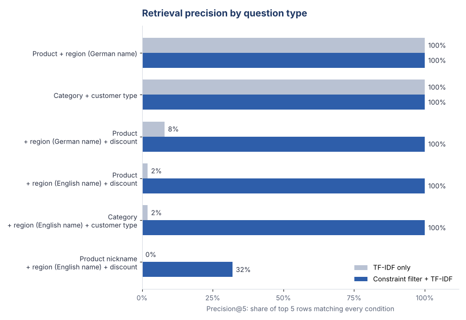

# Retrieval-Augmented Answers over Sales Data

A retrieval-augmented generation (RAG) system answers a question by first retrieving the records most relevant to it, then writing an answer grounded in those records. If retrieval brings back the wrong rows, the answer is confidently wrong.

This project rebuilds a TF-IDF retrieval pipeline over a 30,000-row beverage sales table, diagnoses why it returned the wrong rows for a simple business question, fixes it, and measures the fix on 60 labelled questions.

**Result:** precision@5 rose from **35% to 89%**, and the remaining gap is measured and explained.

**Skills:** Python, retrieval and RAG design, TF-IDF and cosine similarity, evaluation design, root cause analysis



## The question that went wrong

In the original team assignment, we asked the pipeline: *"Show Coca-Cola products sold in Bavaria with a 10% discount."* It returned Coca-Cola rows from Bremen and Sachsen, some with no discount at all. The answer said so honestly, but it did not answer the question.

Rebuilt here, the plain TF-IDF retriever does the same thing:

```
== TF-IDF only
  Product                 Region Customer_Type  Discount  Quantity  Total_Price
Coca-Cola    Nordrhein-Westfalen           B2C         0        10        15.10
Coca-Cola    Nordrhein-Westfalen           B2C         0        10        15.10
Coca-Cola      Baden-Württemberg           B2C         0        10        15.10
Coca-Cola Mecklenburg-Vorpommern           B2C         0        10        15.10
Coca-Cola    Nordrhein-Westfalen           B2C         0         5         7.10
```

## Root cause

1. **Language mismatch.** The data stores German region names (*Bayern*), the question used English (*Bavaria*). Lexical retrieval has no way to connect the two, so the region condition is silently dropped.
2. **Numbers treated as words.** TF-IDF turns "10% discount" into the token `10`, which matches rows with `Quantity: 10` just as well as rows with a 10% discount. Every row above has a quantity of 10 or 5 and no discount.
3. **Conditions treated as preferences.** Similarity ranking rewards rows that match *most* of the question. A business question like this one has hard conditions: a row that is in the wrong region is not "less relevant", it is wrong.

## The fix: read the conditions, filter, then rank

The hybrid retriever parses hard conditions out of the question (product, category, region including English names, customer type, discount), keeps only rows that satisfy all of them, and ranks those rows by the same TF-IDF similarity. When nothing satisfies every condition, it says so instead of returning near misses.

```
== Constraint filter + TF-IDF
Constraints read from the question: {'product': 'Coca-Cola', 'region': 'Bayern', 'discount': 10}
  Product Region Customer_Type  Discount  Quantity  Total_Price
Coca-Cola Bayern           B2B        10        32        44.64
Coca-Cola Bayern           B2B        10        41        52.40
...
Based on the 5 most relevant records: products Coca-Cola; regions Bayern; customer types B2B;
discounts 10%. Average quantity 36.6 units, average order line 49.15 EUR.
```

## Evaluation

60 questions generated from six templates, each with known ground-truth conditions. Precision@5 is the share of the top 5 rows that satisfy every condition in the question.

| Question type | TF-IDF only | Constraint filter + TF-IDF |
|---|---|---|
| Product + region (German name) | 100% | 100% |
| Category + customer type | 100% | 100% |
| Product + region (German name) + discount | 8% | 100% |
| Product + region (English name) + discount | 2% | 100% |
| Category + region (English name) + customer type | 2% | 100% |
| Product nickname + region (English name) + discount | 0% | 32% |
| **All questions** | **35%** | **89%** |

**How to read it:** plain TF-IDF is fine when the question uses the exact words in the data. It collapses as soon as a question mixes a number or a translated name into the conditions, which is how business users actually ask.

**Limits:** the hybrid only reaches 100% on questions phrased in vocabulary it knows. Nicknames such as "Coke" or "Becks" are not in its dictionary, so it falls back to similarity and drops to 32%. The next step is to have a language model translate each question into structured filters (or SQL) and keep this question set as the regression test, so any new retriever has to beat these numbers before it ships.

## Run it

```bash
pip install -r requirements.txt
python ask.py "Show Coca-Cola sold in Bavaria with a 10% discount"   # compare both retrievers on any question
python eval/evaluate.py                                              # rerun the evaluation and the chart
python -m unittest discover tests                                    # parser and retriever checks
python data/generate_sales.py                                        # regenerate the dataset (fixed seed)
```

## Project structure

```
rag/pipeline.py          index, question parser, both retrievers, grounded answer
ask.py                   command-line comparison of the two retrievers
eval/evaluate.py         labelled question set, precision@5, chart
eval/results.csv         per-question results
docs/evaluation.md       summary table
data/generate_sales.py   reproducible dataset generator
data/beverage_sales.csv  30,092 order lines, 2021 to 2023
```

## About the data

The dataset is synthetic. It mirrors the structure of the beverage sales dataset used in the original assignment (product, category, German region, customer type, quantity, discount, price) so the behaviour can be reproduced and measured. Brand names are used as product labels only; every order, customer, and price is fictional.

## Credits

Built on a four-person team project at Alliant International University (August 2026), with Mathilde, Mahika, and Etienne. The team built two TF-IDF RAG simulations in Google Colab and observed the Bavaria result. This repository, by Emma Larroze, rebuilds the pipeline as reusable code, diagnoses that result, and adds the hybrid retriever, the evaluation, and the tests.
